# Gravity Boundary Review v1

**Task:** 13l2 — Solver/Evaluator Data-Boundary Review  
**Reviewer:** Gravity (Agent 3 / Antigravity)  
**Date:** 2026-10-22  
**Base commit reviewed:** `44c0653024ad099f4b6539355c9b6bc358c9e06d`  
**Snapshot ID:** `fd1a37e52353248661f72cd65d55d81d467f075deae5afb2f39fafe69be84568`  
**Supporting plan IDs:** 4j, 7e, 8g  
**Status of this review:** Static analysis only; no code execution performed.

---

## 1. Data-Flow Map

The following traces the end-to-end data path from frozen task input to private stored result, naming every function and type at each edge.

### 1.1 Mermaid Flow Diagram

```mermaid
flowchart TD
    A["Frozen task manifest\ndata/issue-prompts-v1.lock.json\n(TRUSTED_MANIFEST_ID pinned in code)"]
    B["_trusted_bundle()\ninput_guard_v2.py:38\nVerifies manifest digest, inventory\ndigest, all frozen source hashes,\nmodel_evaluation_registered=False"]
    C["build_solver_input(task_id)\ninput_guard_v2.py:137\nOnly approved task_id; callers\ncannot supply records/issues"]
    D["SolverInput\ntask_view.py:76\nFields: issue_text + source_archive\nonly; provenance stays outside"]
    E["DockerSandbox\ndocker_sandbox.py:230\nSelf-contained bounded workspace;\nno issue/record/scorer reference"]
    F["Bounded command feedback\nFakeStep(command, output[:3000],\nexit_code, timed_out)\nVisible tests: visible_tests_pass"]
    G["make_patch / snapshot export\ndocker_sandbox.py:execute()\nMeasured diff against base files;\nbounded 1 MiB"]
    H["load_contract(task_id)\nscoring_contract.py:82\nRe-runs guard v2; verifies record\nvs manifest; checks archive digest"]
    I["prepare_candidate_reference()\nscoring_contract.py:127\nMerges candidate source into\nrestored test archive; editable_\nsource() policy enforced"]
    J["judge_receipt() / assess_candidate()\nscoring_contract.py:145\ncandidate_outcomes.py:20\nPure receipt check; no gold access"]
    K["run_development_score()\ndocker_scoring_v2.py:120\nSynthetic IDs only; verified\nprofile tuple; baseline check"]
    L["ReceiptDecision / CandidateDecision\nstatus+reason+phase+candidate_outcome"]
    M["ExecutionRecord\nrecords.py:260\nIdentity+usage+metrics+patch;\nexplicitly without evaluator score"]
    N["ResultStore.save_record()\nresults.py:144\nSynthetic: atomic completion;\nNon-synthetic: uncertain fence"]
    O["Private SQLite store\nexecution_records table\nImmutable; no evaluator column;\nno public export API"]
    P["valuation_history()\nAppend-only cost_valuations;\nno 'latest is official' selector"]

    A -->|"_read() + digest check"| B
    B -->|"manifest+inventory"| C
    C -->|"_original_snapshot(repo, base_sha)\n_reject_substitution() x2\narchive hash check"| D
    D -->|"issue_text+source_archive"| E
    E -->|"FakeStep return"| F
    F -->|"output[:OUTPUT_BYTES=3000]\nvisible pass/fail only"| E
    E -->|"patch = make_patch(base, current)\n_bounded_run; cleanup"| G
    G -->|"candidate_archive + patch str"| H
    H -->|"load_contract → guard v2\n→ _reject_substitution x2"| I
    I -->|"editable_source() filter\nno gold/test bytes to agent"| J
    J -->|"judge_receipt → assess_candidate\nbaseline_is_operational if needed"| K
    K -->|"CandidateScore (status,phase,\ncandidate_outcome, envelope)"| L
    L -.->|"NOT connected yet\n(missing adapter 5e)"| M
    D -->|"SolverIdentity.solver_key()\ndomain_hash over all config"| M
    M -->|"save_record(claim, record)"| N
    N -->|"_finish_synthetic or\n_stop(uncertain)"| O
    O -->|"append_valuation()"| P
```

### 1.2 Edge-by-Edge Function and Data Table

| Edge | Caller | Function / Type | Allowed data | Forbidden data |
|------|--------|-----------------|--------------|----------------|
| Manifest → Guard | `build_solver_input` | `_trusted_bundle()` line 38 | Pinned manifest ID, frozen source hashes | Caller-supplied records, alternative manifests |
| Guard → SolverInput | `build_solver_input` line 137 | `_original_snapshot()`, `_reject_substitution()` | base commit blobs only | Fixed-tests snapshot, worktree files |
| SolverInput → Sandbox | `DockerSandbox.start()` | `files_from_archive()` | `issue_text`, `source_archive` | Scoring contract, test IDs, fix SHA, history |
| Sandbox → Agent | `DockerSandbox.execute()` | `FakeStep` | `output[:3000]`, `exit_code`, `visible_tests_pass` | Internal container paths, hidden test IDs |
| Sandbox → Patch | `DockerSandbox.execute()` | `make_patch(base, current)` | Bounded diff vs original base | Gold patch, fix contents |
| Patch → Evaluator | `load_contract()` | `guard.build_solver_input()` (re-invoked) | Approved task ID only | Agent messages, visible test feedback |
| Contract → Reference | `prepare_candidate_reference()` | `editable_source()` filter | Candidate source bytes under policy | Test files, conftest, hidden gold |
| Reference → Judge | `judge_receipt()` / `assess_candidate()` | `ReceiptDecision`, `CandidateDecision` | Image-verified receipt data | Scoring contract test IDs to agent |
| Score → Store | **MISSING** (task 5e) | Proposed: `ResultStore.save_record()` | `ExecutionRecord` with identity | Evaluator score column in record |
| Store → Valuation | `append_valuation()` | `CostValuation.compute()` | Usage evidence, pricing snapshot | "Latest is official" selection |

---

## 2. Guard and Identity Enforcement at Call Sites

### 2.1 Runtime Input Guard v2 — Call Site Trace

**File:** `dojo/solve/input_guard_v2.py`

`build_solver_input(task_id)` at line 137 is the **only authorized entry point** for solver input. Static review confirms:

- **Line 139:** `_trusted_bundle()` is called unconditionally before any task lookup. This verifies the hardcoded `TRUSTED_MANIFEST_ID = "cf3a35d43c7a065956bf93ac86b2e4c8247f35ecac89c830b2732fb5a359b4c7"` against the manifest's self-hash and the inventory digest.  
- **Lines 47-50:** `model_evaluation_registered is not False` raises `InputIntegrityError`. This is a **strict identity check** (`is not False`), blocking `None` and truthy values.  
- **Lines 51-57:** Every frozen source file listed in `manifest["sources"]` is read and SHA-256 verified. Missing or modified files raise immediately.  
- **Lines 64-67:** Each task row in the manifest is checked against the inventory row on `task_id`, `split`, `record_sha256`, `text_sha256` keys with strict equality.

**Git substitution refusal (lines 71–99):**  
`_git()` strips all `GIT_*` environment variables and adds `GIT_NO_REPLACE_OBJECTS=1`, `--no-replace-objects` flag, and `protocol.allow=never`. `_reject_substitution()` additionally reads `refs/replace/` refs and graft files. This call occurs **twice** in `build_solver_input` (line 156, line 165) — before and after the archive read — providing defense-in-depth against TOCTOU substitution.

**Frozen-source / input binding:**  
- Archive hash is compared against `binding["original_base_archive_sha256"]` (line 166-167) before returning `SolverInput`.
- `_original_snapshot()` validates every blob: mode must be `100644` or `100755`, kind must be `blob`, path passes `safe_path()`, size matches header, no entry exceeds `MAX_FILES` or `MAX_BYTES`.

**Evidence class:** Confirmed by source.

### 2.2 Scoring Contract Load — Call Site Trace

**File:** `dojo/eval/scoring_contract.py`, `load_contract()` line 82

- Line 84: Re-calls `guard.build_solver_input(task_id, repo=repo)` — the full guard chain runs again for the evaluator.
- Lines 85-86: Re-invokes `guard._trusted_bundle()` independently.
- Lines 90-94: Validates `record_sha256` and `digest()` against manifest binding; checks `status == "eligible_task"` and `record.task_id == task_id`.
- Line 95-96: Re-checks archive hash against `binding["original_base_archive_sha256"]`.
- Lines 98, 111: `_reject_substitution(repo)` called twice around the reference snapshot read.
- Lines 101-114: Fixed-snapshot hash checked against `record["snapshot_sha256"]["fix"]`; restored archive hash checked against `record["snapshot_sha256"]["base"]`.

**Candidate edit scope:**  
`editable_source()` (line 118-124) enforces: within `source_prefix`, `.py` suffix, not a test file (`ChangedFile.is_test`), not in `test/testing/__pycache__` directories, not `conftest.py`/`setup.py`/`sitecustomize.py`/`usercustomize.py`. This is policy-enforced at the evaluator side, **independent of gold patches or task-specific knowledge**.

**Original-source versus fixed-source restoration:**  
Lines 103-114: Fixed files are read with `_original_snapshot(repo, record["fix_sha"])` (substitution-disabled). Only test files (`ChangedFile.is_test`) are overlaid onto the base; no fixed source bytes enter the restored archive. This is structurally enforced, not policy text.

**Archive/file/path bounds:**  
`files_from_archive()` (docker_sandbox.py:105) checks `len(payload) > 20 MiB`, `_valid_name()`, `MAX_FILES`, `MAX_BYTES`. The PRELUDE (docker_sandbox.py:119-144) repeats these checks inside the container before extraction, with additional `..`, `.git`, absolute-path, `-`-leading and control-character checks.

**Private repr/log/message surfaces:**  
- `ExecutionRecord` (records.py:266): `patch` and `trajectory` have `repr=False`, excluded from `__repr__`.
- `ScoringContract` (scoring_contract.py:33): `original_archive` and `restored_archive` have `repr=False`.
- `Artifact` (attempts.py:32): `patch` and `trajectory` have `repr=False`.
- The solver agent receives only `SolverInput` (two fields). The scoring contract is **evaluator-only** (scoring_contract.py:4: "never serialize into solver messages").

**Evidence class:** Confirmed by source.

### 2.3 Missing Adapters (not exploits)

- **Task 5e** (`AttemptStore`/`ResultStore` → runner integration): There is no adapter connecting `run_development_score()` output to `ResultStore.save_record()`. The `CandidateScore` type is not consumed by any store path. This is a missing implementation slice, not a boundary violation in existing code.
- **Non-synthetic dispatch**: `mark_dispatched()` (attempts.py:217) explicitly raises `StoreError("Non-synthetic dispatch remains locked pending tasks 6/8")`. Live transport is structurally blocked.
- **`begin_reservation_intent()`** does not contact a ledger. Its docstring and the `run-store-schema.md` both state this explicitly.

---

## 3. Scorer Image/Collector/Receipt Phases and `candidate_error`

### 3.1 Phase Flow

`run_development_score()` (docker_scoring_v2.py:120):

1. **Guard:** `not contract.task_id.startswith('synthetic_')` raises — benchmark IDs locked.
2. **Profile check:** `(source_prefix, collector_protocol, image_id) not in PROFILES.values()` raises.
3. **Reference preparation:** `prepare_candidate_reference()` applies the source-transfer policy.
4. **Image inspection:** `docker inspect` with `--format={{.Id}}` compared to `contract.image_id` — independent local check.
5. **Candidate execution:** `_execute()` calls `harness(contract.collector_protocol)` — frozen class embedded.
6. **`assess_candidate()` call:** Returns `passed`, `failed`, `requires_baseline`, or `invalid_evidence`.
7. **Baseline check (conditional):** Only if `decision.status == 'requires_baseline'`. Uses `contract.restored_archive`, separate fresh container, same image.
8. **`baseline_is_operational()` check:** Requires exact frozen fail-to-pass/pass-to-pass pattern — not a generic non-zero exit.
9. **Attribution:** If baseline healthy, `CandidateDecision('candidate_error', ...)` — operationally defensible.

### 3.2 Visible Observations vs. Correctness

| Observable | Source | Correctness claim |
|------------|--------|------------------|
| `visible_tests_pass` | `DockerSandbox.execute()` | None — visible tests can pass while hidden tests fail (demonstrated) |
| `has_patch` | `ExecutionRecord.has_patch` property | Structural presence, not correctness |
| `hit_step_cap`, `no_command_rate` | `ExecutionMetrics` derived properties | Run behavior signals, not outcome |
| `CandidateScore.status` | `run_development_score()` | Development reference only; synthetic IDs only |
| `ReceiptDecision` | `judge_receipt()` | Pure policy against frozen expected IDs |

### 3.3 `candidate_error` Baseline Conditions

From `candidate_outcomes.py:93` (`baseline_is_operational()`):

- Phase must be `pytest` (not install).
- `install_exit_code` must be `None`.
- `judge_receipt()` must return `status == 'failed'`.
- `exit_code` must be `1`.
- `passed` must exactly match `contract.pass_to_pass`.
- `failed` must exactly match `contract.fail_to_pass`.
- `skipped` must exactly match `contract.stable_skips`.

A generic exit 1, all-passing baseline, or any diagnostic deviation causes the baseline check to return `False`, which raises `RuntimeError('Operational baseline is unhealthy')` — this is a stop condition, not a silent conversion.

### 3.4 Infrastructure vs. Candidate Errors

| `assess_candidate` return | `candidate_outcome` | Aggregation rule |
|--------------------------|---------------------|-----------------|
| `passed` | `solved` | Count in denominator |
| `failed` | `unsolved` | Count in denominator |
| `candidate_error` | `unsolved` | Count in denominator (baseline confirmed) |
| `invalid_evidence` | `undetermined` | Block aggregation |
| Exception (timeout/cleanup) | No result | Stop; do not score |

**The immutable private `ExecutionRecord` has no evaluator score field.** The `execution_records` SQL table has no `status`/`candidate_outcome` column. The `evaluations` table is separate. The joining boundary requires an explicit future adapter (task 5f/7a) that maps `scoring_key()` to `evaluation_key` and stores the result atomically with the attempt row.

---

## 4. Respect for Known Findings

| Known finding | Status | This review's treatment |
|---------------|--------|------------------------|
| Git replacement handling fixed in guard v2 | Confirmed. `_reject_substitution()` + env stripping + `--no-replace-objects`. | Do not reopen. |
| FD1 ordinary writes isolated by pytest capture | Confirmed per principal-review-assessment-v1.md. | Do not claim FD1 writes corrupt receipts. |
| Shutdown-output corruption addressed via lifetime FD isolation (v2 harness) | Confirmed: STREAMS block in docker_scoring_v2.py:22 redirects FDs 1/2 before any code runs. | Do not claim atexit corruption is unaddressed in v2. |
| Deliberate same-interpreter pytest evasion | Known limitation. Reproduced by owner. AST scans cannot certify absence. | Acknowledged as known limitation; not claimed as new finding. |

---

## 5. Findings Table

| ID | Severity / Impact | File / Function / Line | Claim | Existing Defense | Evidence Class | Smallest Fictional Test | Recommended Fix | Plan ID | New Version? |
|----|-------------------|------------------------|-------|-----------------|----------------|------------------------|-----------------|---------|--------------|
| G-B-01 | **Medium / Missing integration**: No path from `run_development_score()` → `ResultStore`. Scoring output cannot be persisted or counted toward any panel denominator. | `docker_scoring_v2.py` (no caller), `results.py` (no evaluations insert) | Confirmed missing adapter. `CandidateScore` has no consumer in store layer. | None yet — by design (task 5e pending). | **Missing implementation** (not an exploit) | `test_candidate_score_not_stored`: run `run_development_score` on synthetic fixture, assert no row in `execution_records` or `evaluations` — expected behavior today. | Implement 5e: build trusted runner metadata, call `save_record`, then insert evaluation row with `ScoringIdentity.scoring_key()`. Explicitly mark non-synthetic results uncertain. | 5e / 5f | Yes — requires v3 schema `evaluations` extension |
| G-B-02 | **Low / Design note**: `build_solver_input` (task_view.py:103, legacy v1) remains importable and callable. If any future caller uses it instead of v2, the manifest anchor check is bypassed. | `dojo/solve/task_view.py:103` | Hypothesis: a caller accidentally importing v1 bypasses guard. No current runner uses it. | `docs/runtime-input-v2.md` says v2 is mandatory. v1 retained for historical reproduction only. | **Hypothesis** | `test_v1_builder_bypasses_manifest`: call v1 `build_solver_input` with a modified issue dict; confirm it doesn't raise on anchor mismatch. | Add deprecation warning to v1 `build_solver_input`; document in code that it is historical-reproduction-only. Guard future CLI entry points to import only v2. | 3e / 5e | No |
| G-B-03 | **Low / Design note**: `assess_candidate()` accepts `install_exit_code` for `phase=='install'` only for `legacy-v1` protocol. If a future collector uses `method-subtests-v2` and reports an install phase, it returns `invalid_evidence('install_diagnostic')` rather than `requires_baseline`. This is correct behavior but may surprise implementers. | `candidate_outcomes.py:33-37` | Confirmed by source: install phase gated to `legacy-v1`. | Policy is correctly stated in `candidate-outcome-policy.md`. | **Confirmed by source** | `test_v2_install_phase_invalid`: call `assess_candidate` with `collector_protocol='method-subtests-v2'` and `phase='install'`; assert `status=='invalid_evidence'`. | Document explicitly in the collector policy that install-phase diagnostics are a legacy-only concept. | 4d / 4g | No |
| G-B-04 | **Low / Observation**: `SolverIdentity.__post_init__` enforces `model_id.startswith("nvidia/")` and `api_base in APPROVED_API_BASES`. However, the `SolverInput` returned by the guard contains no reference to `SolverIdentity` fields. The identity must be constructed separately by the runner (task 5e), with no structural enforcement that `input_protocol_sha256` matches the actual guard version used. | `identity.py:459-462`, `input_guard_v2.py:168` | Hypothesis: a runner could construct a `SolverIdentity` with an incorrect `input_protocol_sha256`. No runner exists yet to exploit this. | Existing: `SolverIdentity` validates format; `AttemptStore._load()` round-trips identity canonical JSON. | **Hypothesis** | `test_identity_protocol_hash_mismatch`: store a run with a fake `input_protocol_sha256`; verify `_load()` catches the inconsistency via canonical round-trip. | In the future runner (5e), derive `input_protocol_sha256 = sha256(canonical_json_bytes(guard_check_all()))` before constructing identity, and assert it matches. | 5e | No |
| G-B-05 | **Informational**: The `observation_chars` limit in `LimitsSpec` bounds **`limits.observation_chars`** (max 3000), but the actual feedback truncation is hard-coded as `output[:OUTPUT_BYTES=3000]` in `docker_sandbox.py:306`. If a future `RunSettings`-derived identity used a smaller `observation_chars`, the harness would still emit 3000 chars. | `identity.py:297`, `docker_sandbox.py:28,306` | Hypothesis: `observation_chars` in identity is not yet enforced in the sandbox feedback path. | No confirmed bypass — both are currently 3000. | **Hypothesis** | `test_observation_chars_enforced`: set `observation_chars=500` in identity; run sandbox; assert returned output is ≤500 chars. | Thread `limits.observation_chars` from `RunSettings` / `SolverIdentity` into `DockerSandbox.OUTPUT_BYTES` at construction time. | 5e | No |
| G-B-06 | **Known Limitation** (pre-existing, documented): Deliberate pytest monkeypatch evasion. Candidate code can wrap `_pytest.python.Function.runtest` in the same interpreter, swallowing `AssertionError`. Reproduced by owner. | `docker_scoring_v2.py` (harness), `principal-review-assessment-v1.md:168` | Known limitation. FD isolation, frozen test restoration, and image pinning do not protect against in-process interpreter attacks. | Acknowledged in threat model (4j PARTIAL). AST scan rejected as unreliable. | **Known limitation** | N/A — do not propose a fictional test that claims to "fix" this. | Stronger isolation (separate process/interpreter for candidate and evaluator) requires explicit new design. Do not silently extend current threat model claims. | 4j | Yes (if addressed) |

**Verdict: No confirmed new defect found beyond known limitations and missing-implementation gaps (5e, 5f, 4j). All identified items are either missing adapters, hypotheses, or pre-acknowledged limitations.**

---

## 6. Bounded Pre-Registration Acceptance Checklist

### 6.1 Checklist

Before any registered benchmark evaluation run is accepted:

| # | Check | Owner | Status |
|---|-------|-------|--------|
| 1 | `check_all()` in `input_guard_v2` passes all 63 task archives | Primary | DONE (documented) |
| 2 | `check_all()` in `scoring_contract` passes all 63 contracts | Primary | DONE (documented) |
| 3 | Stage B registration committed and `model_evaluation_registered` = `True` in a separate versioned file (not editing frozen PREREGISTER.md) | Primary | NOT DONE (PLANNED) |
| 4 | `SolverIdentity` constructed with verified `input_protocol_sha256`, approved `model_id` and `api_base`, and correct `namespace='live'` only after 6/8 gates | Primary (5e) | NOT DONE |
| 5 | `run_development_score` restricted to `synthetic_` IDs; benchmark gate in actual runner uses `ScoringIdentity.registration_id` linked to verified Stage B | Primary (5f/7a) | NOT DONE |
| 6 | `ResultStore.save_record()` called with fully validated `ExecutionRecord`; non-synthetic results stored as uncertain only | Primary (5e/5d) | PARTIAL (store exists; runner missing) |
| 7 | `evaluations` table populated via explicit `ScoringIdentity.scoring_key()` — no synthetic-to-registered promotion by namespace change alone | Primary (5f) | NOT DONE |
| 8 | Denominator rules specified and enforced: `candidate_error` counts as unsolved; `invalid_evidence` blocks publication until resolved | Primary (5f) | NOT DONE (PLANNED) |
| 9 | No gold/hidden test IDs reachable from any agent message, visible feedback, or trajectory log | Primary (7e) | PARTIAL (structural; canary regression exists) |
| 10 | Financial gates: usable credit confirmed, per-run cap enforced, unknown usage stops run | Primary (6a–6h) | GATED |
| 11 | Cleanup uncertainty stops run (not silently excluded) | Primary | DONE (raises RuntimeError) |
| 12 | Threat model sign-off for interpreter-level evasion risk accepted or stronger isolation designed | Primary (4j) | PARTIAL |

### 6.2 Threat Model Discussion

**Current restricted benchmark use is supportable** for the following stated threat model:
- Adversary: a model that may attempt to manipulate test outcomes through Python-level attacks (monkeypatching, descriptor manipulation).
- Trust boundary: the Docker container with pinned image, no network, no mounts, bounded resources.
- **Supported claims**: input artifact identity, test-file restoration integrity, correct receipts from well-behaved code, and correct evaluation of outputs from a cooperative solver.
- **Not supported**: authentication of receipts against adversarial Python in the same interpreter; AST scanning as a completeness guarantee.

**What stronger hostile-code isolation would require:**
- Separate interpreter process for candidate code and evaluator/collector.
- Kernel-level isolation (e.g., seccomp filter on `ptrace`, `mprotect`, interpreter object writes).
- Receipt authentication via a side channel not accessible to candidate code (e.g., kernel-level marker or separate process with no shared memory).

**Recommendation (non-binding; 4j decision is owner's):** The current model is defensible for a restricted benchmark using cooperative solvers, provided the threat model is explicitly stated in public submission materials. For adversarial evaluation, stronger isolation is required.

---

*END BOUNDARY REVIEW — Task 13l2*
